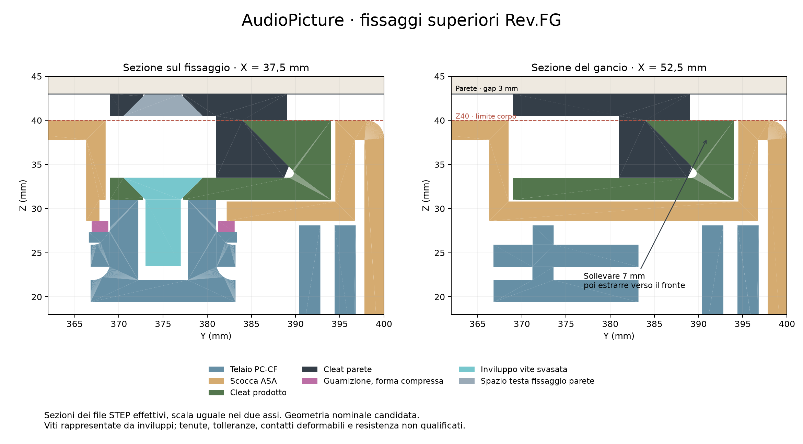

# AudioPicture V2.2 — Rev.FG, 14 ottobre 2026

Checkpoint digitale parziale, con esecuzioni reali. **Il prodotto non è pronto per la produzione.** La prova d'angolo sul telaio aggiornato fallisce ancora e predice interferenza con il DML. Il budget massimo di 250 g resta rimosso; non viene introdotto un nuovo limite.

Baseline Git verificata: `08def92a06e8a09cc321664966e159ea339dc8b5`. Il registro conserva gli esiti storici con il loro ambito: il numero di PASS non è una percentuale di completamento.

## Geometria selezionata e dipendenze

Il candidato corrente è descritto da [`upper-mounts-chamfer/execution.json`](../evidence/rev-fg/upper-mounts-chamfer/execution.json). Deriva dal candidato `upper-mounts-deep`, modificando esclusivamente la punta dei due ganci a parete. Telaio, shell, guarnizioni e viti rappresentate sono copiati byte per byte. La mesh e le due analisi `upper-frame-runs` si riferiscono quindi esattamente al telaio del candidato corrente.

I candidati precedenti `frame` e `fixed-seals` hanno geometrie differenti: le loro analisi restano evidenze di sviluppo, non risultati trasferibili al telaio corrente.

Le quattro sedi inserti sono centrate a X = 37,5 / 67,5 / 252,5 / 282,5 mm, Y = 375 mm. I fori nominali sono Ø5,6 mm, profondi 9,1 mm, Z = 21,9…31 mm, con boss Ø12 mm, fondo 2,5 mm e raccordo alla radice R2. Sono quote candidate da calibrare per il processo di stampa e installazione dell'inserto ruthex RX-M4x8.1, non tolleranze produttive qualificate.

I due ganci del prodotto hanno larghezza 50 mm e profondità nominale d'ingaggio 6,5 mm. Le viti candidate sono **PTS A79910410, ISO 10642 A2, M4×10 a testa svasata**. I 10 mm includono la testa; l'ingaggio nominale nell'inserto è 7,5 mm, con riserva 0,6 mm rispetto alla lunghezza nominale dell'inserto e 1,6 mm rispetto al fondo del foro. La testa è rappresentata mediante inviluppo geometrico, non filettatura o contatto precaricato. La precedente vite a bottone interferiva con lo sgancio ed è scartata. [Catalogo PTS archiviato](https://www.pts-uk.com/products/socket-screws/socket-countersunk-screws/metric-a2/a79910410).

La shell ASA presenta due tasche incassate. Quattro rondelle piane comprimibili, Ø interno 12,4 / esterno 16,2 mm, spessore libero nominale 1,57 mm e montato 1,256 mm, separano le tasche dalla cavità posteriore. Sono guarnizioni assiali; non si applica una legge per O-ring. Collari e battute rigide sono presenti nel CAD. Mancano ancora la qualificazione del precarico e delle tolleranze.

Volume del telaio corrente: **384 199,763 mm³**. Massa **calcolata** con densità di catalogo 1,22 g/cm³: **468,724 g**, esclusi inserti, ganci, viti e gli altri componenti. Non è la massa misurata del telaio né quella dell'intero prodotto.

La figura è ricavata dagli STEP reimportati. L'inviluppo del corpo rimane 320 × 400 × 40 mm. I ganci a parete e i distanziali occupano il distacco esterno: 3 mm senza distanziale, 4 o 5 mm con la coppia alternativa da 1 o 2 mm. Queste alternative non si sommano fra loro.

## Verifiche geometriche eseguite

- BREP, numero di solidi, volumi e STEP reimportati verificati per le parti esportate; hash delle dipendenze e degli artefatti registrati.
- **187 controlli** contro gli ingombri e i keep-out grossolani autorevoli: nessuna sovrapposizione nelle parti controllate. Questo non sostituisce il CAD esatto di componenti, connettori e cablaggi, né la misura RF.
- Percorso continuo di sgancio verificato con inviluppo geometrico conservativo: **sollevamento di 7 mm**, quindi estrazione verso il frontale. Non si tratta soltanto di alcune pose campionate. Il controllo include telaio, shell, DML, guarnizioni, ganci superiori e inviluppi viti rappresentati. Non include fissaggi inferiori ancora da completare, deformazioni o cavi.
- Lo smusso piano sulla punta dei ganci a parete elimina l'ambiguità del precedente inviluppo conservativo a spigolo vivo rispetto al raccordo del gancio del prodotto. L'audit conservativo precedente era inconcludente per quel raccordo; non dimostrava da solo una collisione della punta arrotondata reale.
- Le teste delle viti a parete devono restare contenute nell'inviluppo svasato modellato. La scelta del tassello, della lunghezza e del supporto murario rimane aperta.

Evidenze: [`independent-audit.json`](../evidence/rev-fg/upper-mounts-chamfer/independent-audit.json), con verifica indipendente degli STEP e degli hash. Nessun esito nominale certifica resistenza, tolleranze o comportamento del contatto reale.

## Cavità d'aria e labyrinth

Il confronto booleano conferma che il materiale della regione delle **22 celle** preesistenti non cambia. Questa verifica conserva la precedente topologia verificata; non equivale a dichiarare trattate tutte le aperture di un assemblaggio ancora incompleto.

Con le 22 aperture chiuse esclusivamente da tappi diagnostici, il dominio d'aria presenta **5 componenti**. La cavità posteriore misura **3 131 684,982 mm³** ed è separata dal frontale e dalle due tasche dei ganci. Una piccola cavità isolata misura 1 027,584 mm³: è una componente geometrica, non una misura CFD di volume stagnante. Il residuo massimo nella conservazione incrementale del volume è 0,0000727 mm³.

Togliendo a turno ciascuna delle quattro guarnizioni dei boss, la rispettiva tasca si riconnette alla cavità posteriore. Questi controlli negativi verificano che la separazione dipenda dalle guarnizioni modellate. Nel candidato precedente sono verificati anche i controlli di rimozione della guarnizione DML e di quella radiale telaio-shell.

Le guarnizioni CAD sono assunte impermeabili. Non è una prova di tenuta. **I tappi diagnostici non appartengono al prodotto né alle condizioni al contorno CFD.** Connettività di 22 aperture, trattamento labyrinth, tenuta e prestazione acustica restano proprietà distinte.

## Analisi strutturali effettivamente eseguite

Quattro esecuzioni CalculiX 2.23 completate, con output, equilibrio delle forze e controllo della geometria deformata. Le analisi sono non lineari geometriche, con proprietà ortotrope **normalizzate**: E1 = E2 = 1900 MPa, E3/E1 = 0,2 e rapporti di taglio debole = 0,25. Questi numeri descrivono sensibilità, non proprietà misurate o ammissibili di PC-CF stampato.

Le condizioni includono sedi superiori idealmente vincolate, appoggi inferiori GAPUNI senza attrito e un vincolo anti-estrazione ideale. **Non è stato eseguito il contatto reale tra ganci metallici, viti e parete.** Non si ricava un'accettazione del fissaggio dal fatto che i nodi vincolati non si spostino.

- Candidato iniziale con fori aggiornati, LC1 100 N, orientamento debole Y: spostamento massimo 5,222907 mm; separazione conservativa dal DML almeno 0,780035 mm.
- Candidato con appoggi guarnizioni, LC4 angolo inferiore destro 30 N, orientamento debole Z: spostamento normale 1,133143 mm, **FAIL** rispetto a 1 mm. Il raffinamento geometrico trova 22 testimoni robusti d'interferenza col DML.
- **Telaio corrente**, LC1 100 N, orientamento debole Y: spostamento massimo 5,039525 mm; massimo normale 0,298028 mm; separazione conservativa dal DML almeno **0,823384 mm**. PASS limitato alla separazione finale dell'intero elemento quadratico nel modello.
- **Telaio corrente**, LC4 angolo inferiore destro 30 N, orientamento debole Z: spostamento normale **1,141787 mm, FAIL**. Il raffinamento trova **19 testimoni robusti d'interferenza**, con margine interno massimo 0,007158 mm. Il DML è un ingombro fisso per l'audit; il suo contatto meccanico non è risolto.

La mesh corrente M0 contiene **246 574 nodi / 137 215 elementi C3D10**; nessun Jacobiano non positivo, SICN minimo 0,009985. Il residuo massimo delle forze nei due casi correnti è inferiore a 0,000002 N. Jacobiani positivi ed equilibrio non dimostrano convergenza o accuratezza della tensione locale.

La convergenza della geometria corrente, la matrice completa LC1–LC7 / MAT-A–B–C / temperature, il contatto reale, le resistenze ortotrope e il buckling dell'assemblaggio restano **OPEN**. I risultati precedenti non vengono trasferiti automaticamente alle nuove sedi.

## Guarnizioni e dati di catalogo

L'aritmetica usa il foglio [Rogers PORON 4701-30](https://www.rogerscorp.com/-/media/project/rogerscorp/documents/elastomeric-material-solutions/poron/english/data-sheets/17-006-poron-4701-30-very-soft.pdf), archiviato con SHA-256. La famiglia da 320 kg/m³ indica ±10% sullo spessore nell'intervallo pertinente. Il codice acquistabile preciso, l'adesivo e la curva del materiale effettivo non sono selezionati e qualificati.

Per mantenere compressione 10–30% su tutto l'intervallo di spessore, la guarnizione DML da 2 mm richiede un gap combinato 1,54…1,62 mm. Rispetto al nominale 1,60 mm resta un budget simmetrico di appena **±0,020 mm**. Per le guarnizioni da 1,57 mm, gap nominale 1,256 mm, il budget simmetrico è **±0,0157 mm**. Sono requisiti condizionali sulla somma di stampa, planarità e adesivo, non capacità FDM dimostrate. Servono battute regolabili/spessori selezionati e controllo del gap.

Sul solo punto di catalogo al **25%** di compressione, l'area DML di 8016 mm² corrisponde a un riferimento di forza 168,336…440,880 N, tipico 280,560 N. **Non è la forza al 20%**: nessuna interpolazione, legge elastica o precarico è inventato. Il frontale magnetico da 20–30 N non viene accreditato come meccanismo di precarico DML. Il fermo DML fisso e indipendente rimane da progettare.

L'opzione a spessore 0,79 mm con tolleranza di catalogo ±15% è scartata per questo requisito: nessun singolo gap fisso copre la compressione 10–30% sull'intero intervallo. Evidenza: [`gasket-stack/execution.json`](../evidence/rev-fg/gasket-stack/execution.json).

## Lavoro ancora necessario, in ordine di dipendenza

1. Correggere la risposta del telaio in LC4 e l'interferenza deformata; completare cattura inferiore, fermo e precarico DML indipendenti, battute e registro degli spessori.
2. Completare l'assemblaggio con hardware, cablaggi e attraversamenti effettivi; ripetere collisioni, tolleranze, RF, accesso utensili, sgancio e trattamento di ogni apertura.
3. Eseguire la matrice strutturale completa con mesh convergenti e contatti reali; mantenere i risultati condizionali finché materiali, inserti e giunti non hanno dati qualificati.
4. Generare ed eseguire la CFD del prodotto: convezione naturale, conduzione, radiazione, aperture reali, parete a 3/4/5 mm, 3/5/8/10 W, matrice CFD01–CFD05, convergenza <5%, bilancio termico e metriche di ristagno. I benchmark Elmer precedenti qualificano una parte della catena numerica; non sono CFD di AudioPicture.
5. Completare gli schemi nativi MAIN/VOICE/RADAR, i PCB, l'integrazione elettroacustica/RF, il firmware di produzione e la distinta verificata; quindi generare i file produttivi del candidato approvato.
6. Eseguire le prove fisiche già predisposte e quelle aggiunte in [Rev.FG](../manufacturing/real-data-addendum-rev-fg.md). Tutte restano NOT_RUN. I dati fisici assenti non vengono sostituiti da risultati sintetici.

## Rettifica Rev.FE e tracciabilità

La descrizione precedente del caso EU20 LC1 100 N, orientamento debole Y, riportava erroneamente zero nodi campionati nel DML. Il dato reale è **57 nodi**, oltre a 82 testimoni interni dell'audit raffinato. Il README e il rapporto Rev.FE sono corretti; gli output numerici storici restano invariati. L'esempio sintetico separato del controllo Bernstein dimostra la possibile insufficienza del solo campionamento nodale, ma non rende quel caso reale un falso negativo nodale.

Riferimenti: [registro PASS/FAIL/OPEN](validation/rev-fg/gate-register.json), [riepilogo verificabile](validation/rev-fg/summary.json), [provenienza e hash](../evidence/rev-fg/provenance.json), [componenti candidati](components/upper-mount-candidates-rev-fg.json). Il supplemento Rev.FG conserva anche STEP, mesh, input e output solver; integra gli archivi precedenti senza riscriverli. La pubblicazione è un checkpoint di sviluppo, non un'autorizzazione alla costruzione.
