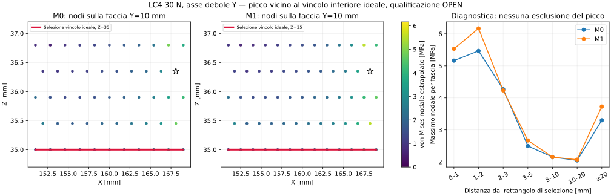

# Rev.FI — approfondimento dei picchi e della cattura inferiore

16 ottobre 2026. **Post-elaborazione eseguita dei risultati esistenti; nessuna nuova simulazione. Nessuna qualificazione delle tensioni o del fissaggio reale.** Integra il [checkpoint Rev.FI](digital-validation-rev-fi.md), lasciando immutati i suoi archivi e le evidenze numeriche originarie.

## Picco inferiore: posizione verificata, causa ancora OPEN

Il picco nodale estrapolato di von Mises passa da 5,466057 MPa in M0 a 6,167378 MPa in M1. I punti sono rispettivamente X168,100 / Y10 / Z36,350 mm e X168,250 / Y10 / Z36,350 mm. Sono su una faccia CAD piana Y10, estesa X151…169 e Z35…36,8 mm; distano 0,45 mm dal bordo CAD più vicino.

I punti di massimo **non sono nodi a spostamento imposto**. La distanza dal nodo di cattura normale ideale più vicino è 1,622498 mm in M0 e 1,544345 mm in M1. La distanza geometrica dal rettangolo usato per selezionare quei vincoli è 1,35 mm. Tale rettangolo non rappresenta automaticamente una superficie fisica interamente a contatto.

Questi dati dimostrano la prossimità al vincolo ideale. Non distinguono da soli concentrazione geometrica, singolarità del vincolo ed effetto di estrapolazione della mesh. Non viene introdotto un raggio entro cui scartare le tensioni e non si attribuisce un PASS a un picco non classificato.

## Un secondo punto impedisce di ignorare la zona inferiore

Anche considerando i nodi ad almeno 20 mm dal rettangolo inferiore, il massimo passa da **3,300141 a 3,727642 MPa**, con differenza **11,4684%** rispetto alla mesh fine. Questo confronto è diagnostico, non un criterio di accettazione basato su un taglio arbitrario del modello.

Il punto M1 è X289,018459 / Y380,298084 / Z27,172 mm, vicino al fissaggio superiore destro UR2 e **sul bordo CAD** della giunzione fra il collare Ø16,8 mm e il resto del telaio. In M0 il punto è a 0,014602 mm da quel bordo. Il collare è generato come anello spesso 1,2 mm, Z26,144…27,344 mm, da `generate_upper_cleats_rev_fg.py`; non è il raccordo di raggio 2 mm della radice del boss. Le facce più vicine sono cilindrica e piana. La classificazione di intaglio/mesh/contatto resta aperta.

La convergenza completa non si può quindi ottenere semplicemente eliminando il picco vicino alla cattura inferiore. Occorre studiare sia il vincolo inferiore reale sia la giunzione del collare superiore, mantenendo spazio guarnizione, compressione e ingombri verificati.

## Forze da trasmettere: risultato del modello, non capacità del pezzo

La reazione normale totale della cattura inferiore ideale nei casi disponibili del telaio corrente con asse debole Y è:

- LC1 verticale 100 N, M0: −0,484850 N;
- LC3 trazione frontale 50 N, M0: +24,774746 N;
- LC4 angolo sinistro 30 N, M0: +47,425485 N;
- LC4 angolo destro 30 N, M0: +47,390859 N;
- LC4 angolo destro 30 N, M1: **+47,609034 N**.

Il segno è quello dell'asse globale Z; il vincolo ideale trasmette entrambi i versi. Il maggiore valore assoluto disponibile è 47,609034 N, ma la matrice LC1–LC7, i baricentri, le temperature e il contatto reale sono incompleti. **Questo valore non è un carico di prova qualificato né una resistenza misurata.** Una cattura reale deve essere progettata con un percorso di carico esplicito; i magneti del frontale e la guarnizione DML non vengono considerati implicitamente parte di tale percorso.

## Evidenze e prossima dipendenza

Lo [script riproducibile](cad/audit_lower_capture_hotspot_rev_fi.py) rilegge i campi FRD e li confronta con le metriche consolidate, verifica gli hash e le coordinate sullo STEP corrente. I 208/332 nodi fittizi degli appoggi, presenti nei FRD con tensione nulla, vengono riconosciuti e separati dai nodi del solido. Le fasce di distanza della figura sono diagnostiche; non sono una prova di convergenza delle tensioni ai punti d'integrazione.

[Output completo con provenienza](../evidence/rev-fi/lower-capture-audit/audit.json). Esecuzione: `audit_lower_capture_hotspot_rev_fi.py --preview /percorso/assoluto/anteprima.png`. L'SVG e il JSON sono versionati direttamente in Git; gli archivi della release Rev.FI rimangono immutati e non includono questo successivo addendum.

Prossima dipendenza progettuale: definire geometria e contatti della cattura inferiore reale, poi risolvere e raffinare localmente anche la giunzione del collare superiore. Il piano delle misure P10 è [integrato](../manufacturing/real-data-addendum-rev-fg.md). La convergenza non singolare, la resistenza, la qualificazione materiale/processo e l'assemblaggio completo restano **OPEN**. Il registro rimane 106 PASS / 43 FAIL / 24 OPEN: questo approfondimento non aggiunge un'accettazione strutturale.
